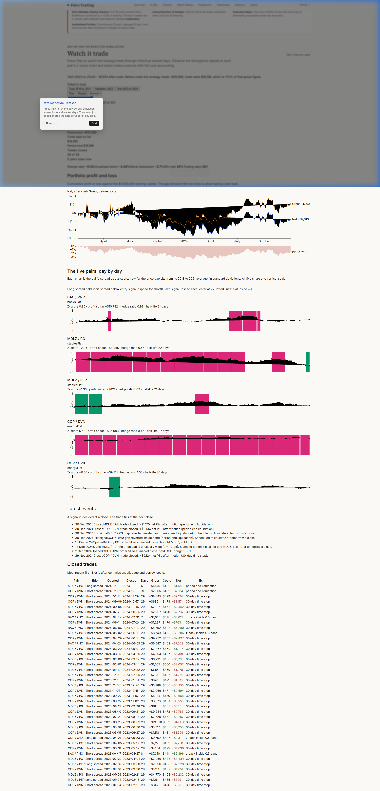
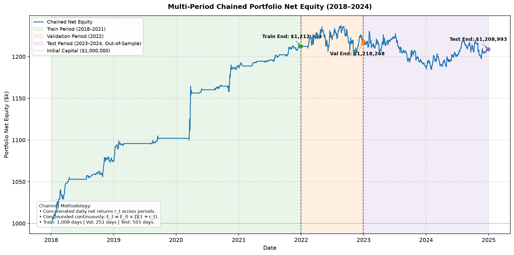
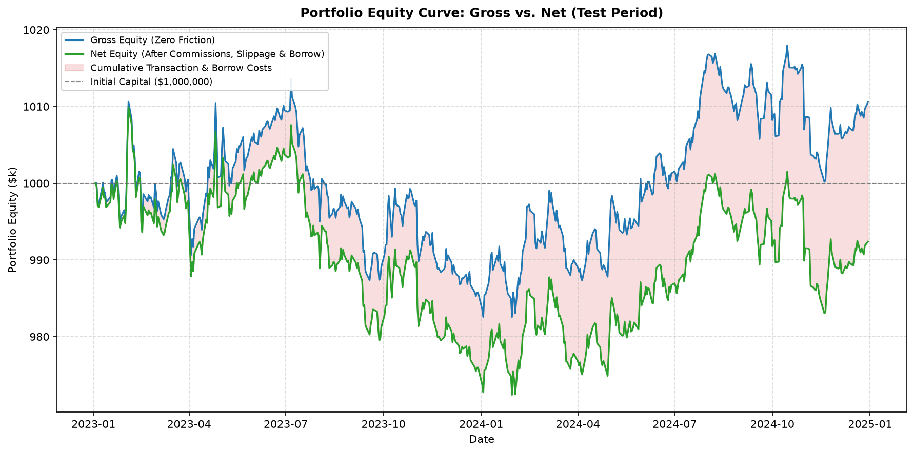
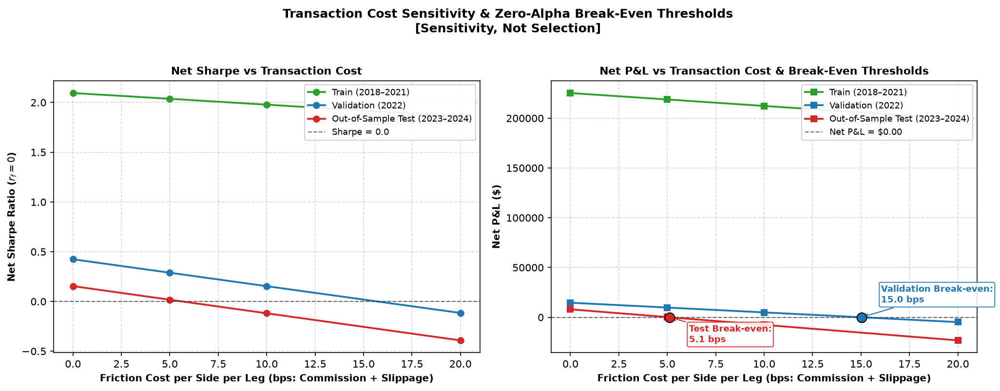
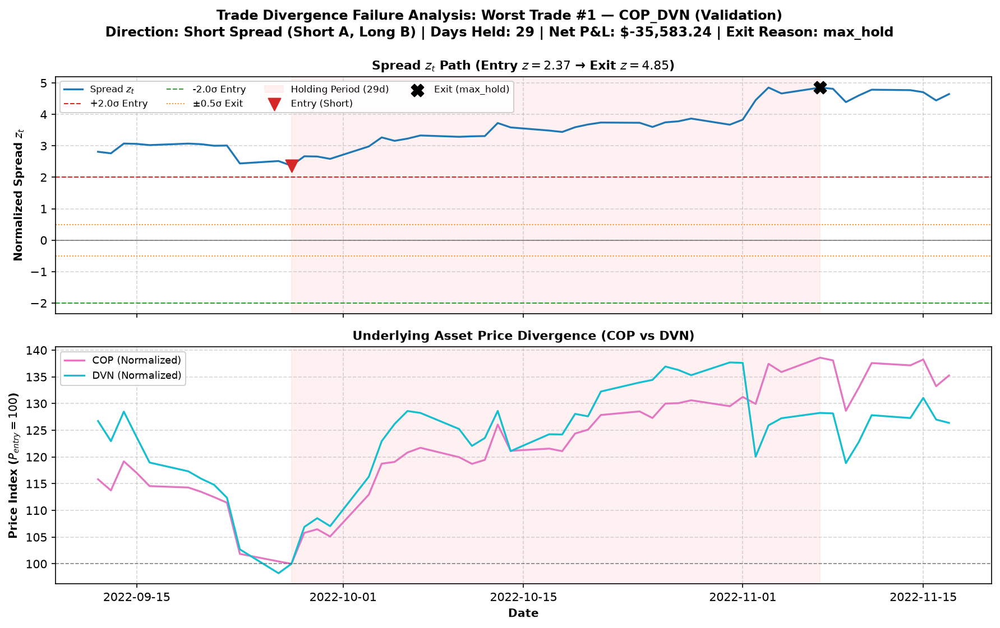

# Statistical Arbitrage in Equity Markets: Cointegration-Based Pairs Trading with Out-of-Sample Validation

**Author:** Aatif Shaikh ([@crys1ss](https://github.com/crys1ss))

[]()
[]()
[]()
[]()
[](https://crys1ss.github.io/stat-arb-pairs-trading/)

> **Live Demo & Interactive Browser Simulator**: [https://crys1ss.github.io/stat-arb-pairs-trading/](https://crys1ss.github.io/stat-arb-pairs-trading/)
>
> Explore pairs trading in 60 seconds, watch the day-by-day historical replay with complete transaction costs, and experiment with strategy parameters directly in your browser.

[](https://crys1ss.github.io/stat-arb-pairs-trading/)

A modular, reproducible quantitative research framework evaluating whether cointegration-based pairs trading generates positive risk-adjusted returns in U.S. large-cap equities after realistic transaction friction, execution delays, and market structural breaks.

---

## 1. Overview & Research Question

Pairs trading is historically grounded in the economic hypothesis of relative valuation equilibrium: fundamentally linked companies within the same industrial sector share common stochastic drivers. While temporary liquidity shocks cause relative prices to dislocate, economic substitution forces are hypothesized to restore mean reversion.

### Research Question
> *Can an intra-sector cointegration pairs-trading strategy achieve positive, statistically significant risk-adjusted returns after realistic execution lag, transaction fees, and short borrow costs in U.S. large-cap equities—and what structural mechanisms explain its performance out-of-sample?*

---

## 2. Headline Results (Out-of-Sample 2023–2024)

Evaluated across an untouched 2-year out-of-sample window (501 active trading days, 2023-01-01 to 2024-12-31) with strictly frozen pre-test model parameters:

* **Gross Trading P&L**: **+$10,586.12** (Gross Sharpe: `0.20`, Gross Return: `+1.06%`)
* **Net P&L After Friction**: **-$7,613.28** (Net Sharpe: `-0.12`, Cost Drag: `171.92%`)
* **Break-Even Cost Threshold**: **5.12 bps** per side per leg (vs. `10.00 bps` baseline execution friction)
* **Screening Reality**: **0 of 45 pairs** survived Holm-Bonferroni correction in training; **2 of 5 fallback picks** failed even uncorrected 5% testing (`COP_DVN` $p=0.053$, `COP_CVX` $p=0.090$).

> **Empirical Bottom Line**: The screen found no truly cointegrated pairs; the fallback basket lost money after transaction costs. Cointegration never existed for `COP_DVN` (which alone accounted for -$36,982.71 in net losses). Rather than cointegration "decaying," we traded noise, and persistent spread divergence compounded when immediate re-entries occurred after 30-day time-stop exits.

---

## 3. Methodology & Mathematical Intuition

```
Raw Prices (Yahoo Finance) ──► Clean Price Panel (close.parquet) ──► ADF / KPSS Stationarity
                                                                            │
Reports & Verification ◄── Performance Metrics ◄── Portfolio Simulator ◄── Cointegration Screening
  • Unit Tests              • HAC Beta Exposure     • 1-Day Execution Lag    • Holm-Bonferroni FWER
  • Failure Analysis        • Friction Breakdown    • Slippage + Borrow      • Half-Life Filter
```

### Step 1: Cointegration & Spread Formulation
For two log-price series $\ln(P_{A,t})$ and $\ln(P_{B,t})$ integrated of order one ($I(1)$), cointegration guarantees a stationary linear combination:

$$s_t = \ln(P_{A,t}) - \hat{\alpha} - \hat{\beta} \ln(P_{B,t}) \sim I(0)$$

where hedge parameters $\hat{\alpha}$ and $\hat{\beta}$ are estimated via Ordinary Least Squares (OLS) strictly over the in-sample calibration window. To eliminate regression normalization bias, we compute bidirectional Engle-Granger tests and evaluate against the conservative maximum p-value: $p_{\text{pair}} = \max(p_{A|B}, p_{B|A})$.

### Step 2: Multiple Testing Control (Holm-Bonferroni)
Screening $m = 45$ intra-sector pairs simultaneously inflates the family-wise error rate ($1 - 0.95^{45} \approx 90.1\%$). We apply the step-down Holm-Bonferroni correction:

$$\tilde{p}_{(i)} = \max_{k \le i} \min\left(1.0, \, (m - k + 1) \cdot p_{(k)}\right)$$

Pairs are further filtered through an Ornstein-Uhlenbeck mean-reversion half-life bound: $t_{1/2} = -\frac{\ln 2}{\gamma} \in [1, 60]\text{ days}$ (where $\gamma < 0$ is the OLS slope of $\Delta s_t = \gamma s_{t-1} + \mu + \epsilon_t$).

### Step 3: Spread Z-Score & Causal Execution Logic
Signals are generated from spread deviations normalized by frozen in-sample mean ($\mu_{\text{train}}$) and volatility ($\sigma_{\text{train}}$):

$$z_t = \frac{s_t - \mu_{\text{train}}}{\sigma_{\text{train}}}$$

* **Long Spread Entry ($z_t \le -2.0$)**: Buy leg A, short leg B ($N_A = \frac{C \cdot |w_A|}{P_{A,t}}$, $N_B = -\text{sgn}(\beta)\frac{C \cdot |w_B|}{P_{B,t}}$).
* **Short Spread Entry ($z_t \ge +2.0$)**: Short leg A, buy leg B.
* **Mean-Reversion Exit ($|z_t| \le 0.5$)**: Close position when spread reverts within 0.5 standard deviations.
* **Time-Stop Liquidation**: Unconditionally liquidate open positions if held for $\ge 30$ trading days.
* **Execution Realism**: Signals evaluated at day $t$ close fill strictly at day $t+1$ close (`execution_lag = 1`). Transaction friction includes 5.0 bps commission + 5.0 bps slippage (10.0 bps/side) plus 50.0 bps annualized short borrow fees (charged daily as $\text{borrow\_bps\_annual} / 10^4 / 252$ on the short leg notional fixed at entry fill).

---

## 4. System Architecture

```
stat-arb-pairs-trading/
├── configs/
│   ├── baseline.yaml            # Canonical in-sample parameters (SHA-256 frozen)
│   ├── test_run.yaml            # Single out-of-sample execution config (unlock_test: true)
│   └── cooldown_validation.yaml # 20-day re-entry cooldown experiment (validation only)
├── src/
│   ├── config.py                # Type-safe dataclass configurations and validation
│   ├── data.py                  # Yahoo Finance retrieval, disk caching, and time slicing
│   ├── validation.py            # Calendar alignment, bad ticks, and monotonic index guards
│   ├── pairs.py                 # Engle-Granger, Holm-Bonferroni, and OU half-life filters
│   ├── signals.py               # Deterministic state-machine signal engine with cooldown
│   ├── backtest.py              # Single-pair backtest simulator with friction tracking
│   ├── portfolio.py             # Multi-pair capital allocation and portfolio aggregator
│   ├── metrics.py               # Annualized CAGR, Sharpe, max drawdown, and turnover
│   ├── failure_analysis.py      # Newey-West HAC beta, CUSUM breaks, and trade autopsy
│   └── plotting.py              # Visualizations and diagnostic charts
├── scripts/
│   ├── fetch_data.py            # Acquire and validate market price dataset
│   ├── run_pipeline.py          # Unified end-to-end research pipeline runner (--recompute mode)
│   ├── run_sensitivity.py       # 84-point parameter robustness and break-even grid
│   ├── run_failure_analysis.py  # Statistical stability and failure mode diagnostics
│   └── compare_cooldown_validation.py # Baseline vs cooldown validation comparison
├── tests/                       # Unit and property-based test suite
├── docs/                        # Research protocol, methodology, and learning notes
│   └── LEARNING_NOTES.md        # Beginner-friendly guide to quant finance & interview Q&A
└── reports/
    ├── research_report.md       # Quantitative research report
    ├── results/                 # Machine-readable CSVs, JSON metrics, and audit logs
    └── figures/                 # Diagnostic SVG/PNG plots
```

---

## 5. Quickstart & Reproducibility

### Installation
Clone the repository and install locked dependencies in a virtual environment:
```bash
git clone https://github.com/crys1ss/stat-arb-pairs-trading.git
cd stat-arb-pairs-trading
python -m venv venv
# On Windows: venv\Scripts\activate | On macOS/Linux: source venv/bin/activate
pip install -r requirements.txt
```

### Data Acquisition
Fetch and validate daily adjusted price history across Banking, Energy, and Consumer Staples universes:
```bash
python scripts/fetch_data.py
```
*Note: Clean prices are persisted to local cache (`data/processed/close.parquet`).*

### Pipeline Execution Modes
Run the end-to-end pipeline in either standard cached mode or verification mode:
```bash
# 1. Standard mode (reuses cached screening and frozen hedge parameters):
python scripts/run_pipeline.py --config configs/test_run.yaml

# 2. Verification mode (recomputes screening and hedge fits from close.parquet, verifies against frozen CSVs with rtol 1e-5, and never overwrites):
python scripts/run_pipeline.py --config configs/test_run.yaml --recompute
```

### Run Test Suite
Execute the deterministic test suite covering signal timing, execution lag, cost accounting, and statistical calculations:
```bash
pytest -q
```

### Rebuild the Website Data
Export pipeline results, price matrices, and frozen parameters to `site/data/` for the public website and simulation playground:
```bash
python scripts/export_site_data.py
```
This script validates data integrity by asserting that trade net P&L matches equity change in each period within $1.

To run the automated client-side simulation engine parity verification:
```bash
node site/tests/parity.js
```

### Deploy to GitHub Pages
The site deploys automatically on every push to `main` via `.github/workflows/pages.yml`. To enable GitHub Pages on your repository:
1. Go to **Settings** > **Pages**
2. Under **Build and deployment**, set **Source** to **GitHub Actions**
3. Once the workflow completes, the site will be live at `https://crys1ss.github.io/stat-arb-pairs-trading/`

---

## 6. Key Empirical Visualizations

### Multi-Period Chained Net Equity (2018–2024)
*Net portfolio equity chained across Calibration (2018–2021), Validation (2022), and Out-of-Sample Test (2023–2024).*


### Out-of-Sample Gross vs. Net Equity Curve
*The strategy delivered steady positive gross trading profits ($+\$10.6\text{k}$) but suffered negative net returns ($-\$7.6\text{k}$) after trade friction ($10.0\text{ bps}$) and short borrow costs ($50\text{ bps/year}$).*


### Transaction Cost Sensitivity & Break-Even Analysis
*Parameter sensitivity across transaction fees and borrow rates reveals a razor-thin break-even margin of 5.12 bps per side per leg. Note on Methodology: All 84 sensitivity variants were evaluated across the 2023–2024 test period; therefore, the variants that turned positive represent hypotheses for future work, not proven improvements or post-hoc fixes.*


### Failure Mode: Non-Reverting Divergence Case Study
*Spread breakdown in `COP_DVN` demonstrating non-reversion and liquidation at the 30-day time-stop horizon, accounting for -$36,982.71 in net losses.*


---

## 7. v1.1 Addendum: Re-entry Cooldown (Validation-Only Evaluation)

Post-mortem failure analysis showed that when a trade reached the 30-day time stop (`max_hold`), the state machine immediately re-entered the exact same losing trade on the next bar if the spread was still wide. This caused repeated losses in `COP_DVN`.

In v1.1, an optional `cooldown_days: int = 0` was introduced to `generate_signals()` (default 0 preserves exact v1 baseline reproducibility). After a `"max_hold"` or `"stop"` exit, entries are blocked for `cooldown_days` bars. Normal `"mean_revert"` exits do not trigger a cooldown.

To avoid test set pollution, the cooldown feature was evaluated **strictly on the 2022 validation period** (`configs/cooldown_validation.yaml`, 20-day cooldown) and never run on the test period:

| Metric | 2022 Validation Baseline (0d) | 2022 Validation Cooldown (20d) | Impact |
| :--- | :---: | :---: | :---: |
| **Net P&L** | +$4,903.47 | **+$17,914.77** | **+$13,011.30** |
| **Gross P&L** | +$16,082.34 | **+$24,900.61** | +$8,818.27 |
| **Friction Costs** | $11,178.86 | **$6,985.84** | **-$4,193.02** |
| **Net Sharpe Ratio** | 0.1537 | **0.6319** | **+0.4782** |
| **Trades** | 24 | **15** | -9 churned trades |
| **Win Rate** | 62.50% | **53.33%** | -9.17% |
| **COP_DVN Net P&L** | -$35,629.83 | **-$18,899.01** | **+$16,730.82** (loss cut) |

**Key Takeaways**:
- The 20-day cooldown prevented immediate re-entry into the diverging `COP_DVN` spread, eliminating 9 churned trades and cutting losses significantly.
- However, `COP_DVN` still lost -$18.9k because cointegration never existed for that pair ($p = 0.053$). Cooldown is a sensible risk mitigation, but cannot turn a broken pair profitable.
- The 20-day cooldown was chosen once and not tuned. It was evaluated on the 2022 validation period only, so it should be confirmed on fresh 2025 data before being treated as a real improvement.
- Full details and CSV saved in `reports/results/cooldown_validation_comparison.csv`.

---

## 8. Limitations & Data-Use Notice

### Modeling & Execution Limitations
1. **Survivorship Bias**: Universe tickers were chosen from current S&P 500 constituents listed continuously from 2018 to 2024, excluding delisted or distressed firms.
2. **Small Universe**: 18 large-cap stocks (45 intra-sector pairs) constrained diversification across idiosyncratic spread shocks.
3. **Dividend Liabilities on Short Borrow**: Cash dividends were adjusted into price series rather than debited as physical cash flows on ex-dividend dates.
4. **Borrow Rate Invariance**: Borrow fee was modeled as a static 50 bps annual rate; hard-to-borrow spikes and recall risks were not simulated.
5. **Close-to-Close Execution**: Fills were executed at day $t+1$ close without modeling Market-on-Close (MOC) order book imbalances.
6. **Zero Endogenous Market Impact**: Fixed 5.0 bps slippage assumed infinite liquidity at close without square-root price impact penalties.
7. **Single Chronological Partition**: The timeline was split once (4y train, 1y validation, 2y test) rather than evaluated via combinatorial purged cross-validation.
8. **Pre-Registered Fallback**: Zero pairs cleared strict Holm-Bonferroni testing in training; the top 5 pairs by raw p-value were traded as an exploratory basket (two of which failed even uncorrected 5% testing).
9. **Borrow Fee Accounting**: Borrow costs were accrued on the short leg notional fixed at entry fill rather than continuously marked to market daily.
10. **Holding Horizon**: The maximum hold timer increments from the signal bar, resulting in trades lasting 29 trading days rather than a full 30 days.

### Data-Use & Educational Disclaimer
*Market data is accessed via the Yahoo Finance API for personal, non-commercial academic research and educational evaluation only. This project does not constitute financial, investment, or trading advice. Past simulated performance is no guarantee of future trading results.*

---

## 9. Future Research Directions

1. **Johansen Multivariate Cointegration**: Extend bivariate regressions to cointegrated triplets and sector baskets ($k > 2$).
2. **Kalman Filter Dynamic Hedge Ratios**: Replace rigid in-sample OLS with state-space models tracking time-varying betas ($\beta_t$).
3. **Walk-Forward Periodic Re-Screening**: Re-estimate cointegration filters and hedge parameters on rolling 12-month windows.
4. **Point-in-Time Historical Constituent Universes**: Integrate survivorship-bias-free historical index constituent panels.
5. **High-Performance C++ Simulation Core**: Re-architect the event-driven backtesting loop into compiled C++ (pybind11) for high-frequency tick analysis.

