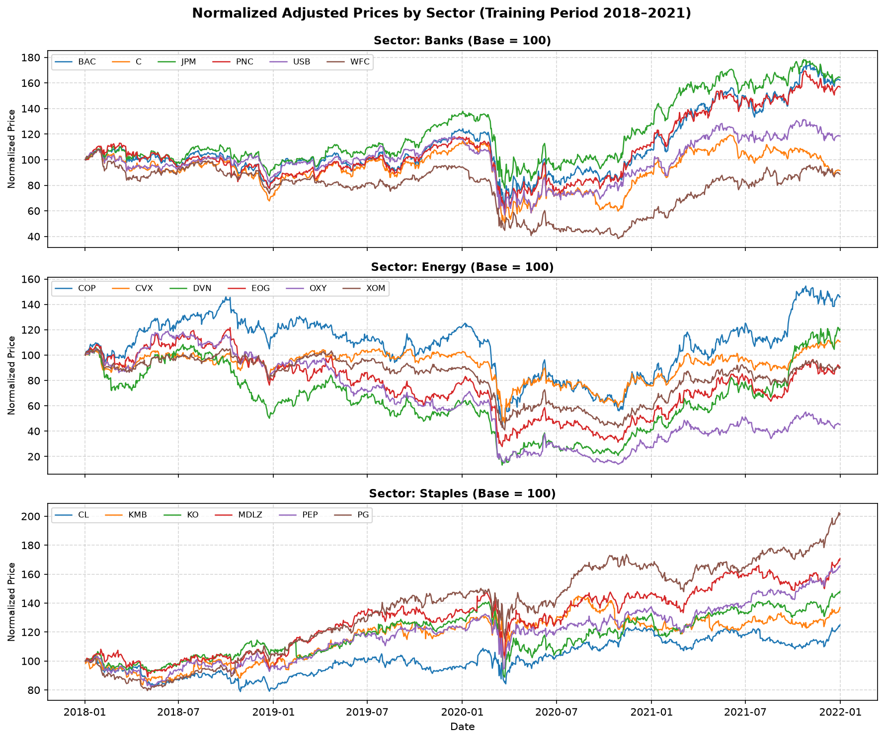
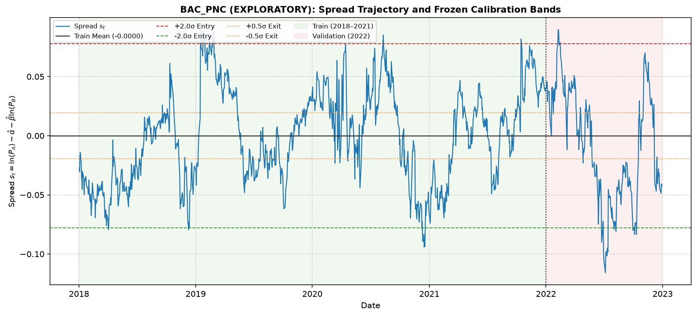
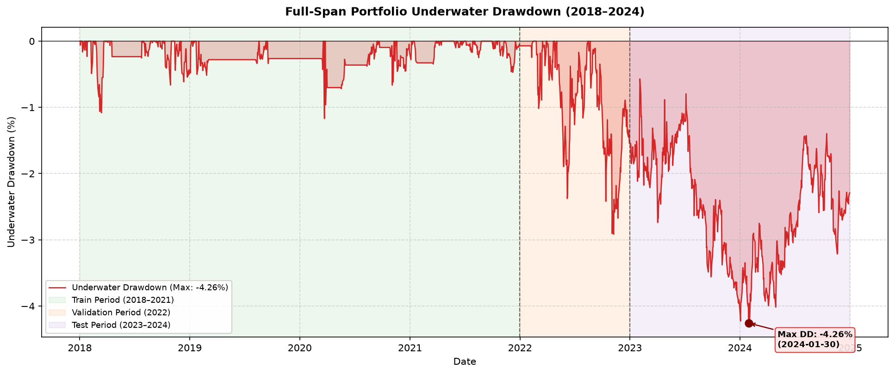
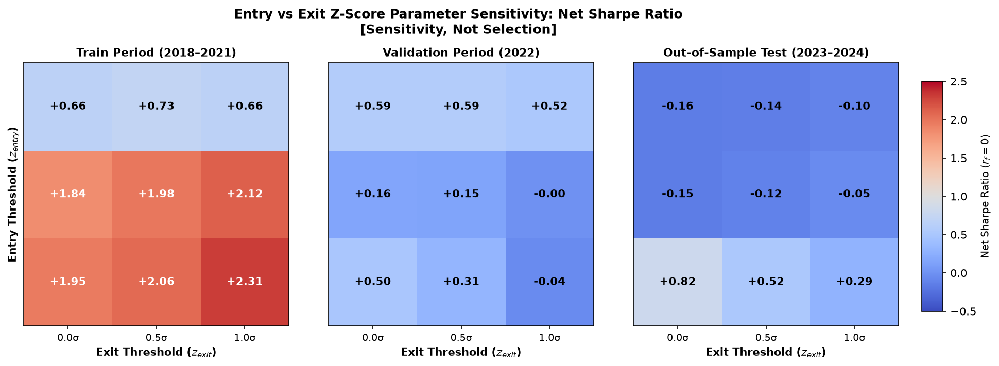

# Statistical Arbitrage in Equity Markets: Cointegration-Based Pairs Trading with Out-of-Sample Validation

**Author:** Aatif Shaikh ([@crys1ss](https://github.com/crys1ss))  
**Date:** October 2026  
**Status:** Completed Research Report (Post-Test Evaluation & Failure Analysis)  
**Baseline SHA-256 Hashes (LF):** `configs/baseline.yaml` (`40f7c5f8...`), `reports/results/selected_pairs.csv` (`6952604f...` [LF normalized; original Windows CRLF was `52c64903...`, see docs/FROZEN_DECISIONS.md §9.1])  
**Git Release Tag:** `frozen-v1`  

---

## 1. Abstract and Research Question

### Core Research Question
Can a cointegration-based pairs trading strategy produce robust, risk-adjusted returns after realistic transaction costs in U.S. large-cap equities, and how sensitive are the results to model assumptions, pair selection filters, and structural market regime changes?

### Plain Answer to the Research Question
In an untouched, out-of-sample evaluation window spanning 2023 to 2024 (501 active trading days), the baseline cointegration pairs-trading strategy **failed** to produce positive net returns after accounting for realistic transaction friction. 

While the statistical signal engine achieved positive gross trading profits of **+$10,586.12** (gross Sharpe **0.1997**, annualized return **+0.53%**), cumulative friction totaled **$18,199.40** ($15,602.81 in commissions/slippage and $2,596.59 in short borrow fees). Transaction costs consumed **171.92%** of gross earnings, producing an ending net loss of **-$7,613.28**, an annualized net CAGR of **-0.38%**, a net Sharpe ratio of **-0.1189**, and a maximum drawdown of **3.71%** lasting 478 trading days.

Out-of-sample failure was driven by **screening failure, noise trading, and structural parameter breakdown**:
1. Zero candidate pairs survived Holm-Bonferroni multiple-testing correction in training; two of the five fallback picks failed even uncorrected 5% testing (`COP_DVN` $p = 0.053$, `COP_CVX` $p = 0.090$). Cointegration never existed for `COP_DVN`, which alone accounted for -$36,982.71 in net losses.
2. All 5 candidate pairs suffered structural breaks over the 2018–2024 horizon (CUSUM test $p < 0.0001$).
3. Zero candidate pairs maintained statistical cointegration in 2023–2024 ($p \in [0.2068, 0.9507]$).
4. The break-even friction threshold in test was **5.12 bps** per side per leg, well below realistic conservative execution costs (10.0 bps).
5. Four of five pairs were profitable out-of-sample (+ $29,369.44 net), but `COP_DVN` experienced persistent divergence, losing **-$36,982.71** (55.74% of absolute portfolio P&L) via 30-day timeout liquidations followed by immediate re-entries.

---

## 2. Financial Intuition and Hypothesis

Pairs trading rests upon the Law of One Price and relative valuation equilibrium. When two companies operate in the same sector with homogeneous business models, their cash flows share an underlying stochastic trend. Temporary supply-demand shocks may dislocate relative prices, but economic substitution forces should restore equilibrium.

Mathematically, this equilibrium is formalized through **cointegration** (Engle and Granger, 1987). Two non-stationary $I(1)$ price series $P_{A,t}$ and $P_{B,t}$ are cointegrated if a linear combination is stationary:
$$s_t = \ln(P_{A,t}) - \alpha - \beta \ln(P_{B,t}) \sim I(0)$$
where $\beta$ is the hedge ratio and $s_t$ is the mean-reverting spread.

### Cointegration vs. Correlation
A critical methodological distinction is between correlation and cointegration:
- **Correlation** measures co-movement in differenced returns ($\rho = \text{Corr}(\Delta \ln P_A, \Delta \ln P_B)$). Highly correlated assets can permanently drift apart if driven by independent random walks.
- **Cointegration** measures equilibrium in price levels, guaranteeing that spread variance $\text{Var}(s_t)$ remains bounded and deviations from mean $\mu$ mean-revert over finite horizons.

---

## 3. Dataset and Universe Selection

The universe consists of 18 liquid U.S. large-cap equities across three sectors (6 per sector):
1. **Banks**: `JPM`, `BAC`, `C`, `WFC`, `USB`, `PNC` (shared credit cycle, NIM, and regulatory drivers).
2. **Energy**: `XOM`, `CVX`, `COP`, `EOG`, `OXY`, `DVN` (shared crude oil and natural gas fundamentals).
3. **Consumer Staples**: `KO`, `PEP`, `PG`, `CL`, `KMB`, `MDLZ` (defensive demand and resilient cash flows).

Daily adjusted prices were collected via Yahoo Finance across 1,760 trading days (2018-01-02 to 2024-12-30) and partitioned chronologically:
- **Training / Calibration**: `2018-01-01` to `2021-12-31` (1,008 days, 4 years).
- **Clean Validation**: `2022-01-01` to `2022-12-31` (251 days, 1 year).
- **Out-of-Sample Test**: `2023-01-01` to `2024-12-31` (501 days, 2 years; locked prior to Day 10).

---

## 4. Statistical Methodology

### Step 1: Unit-Root Integration Testing
ADF and KPSS unit root tests confirmed that all 18 equities are integrated of order one ($I(1)$): non-stationary in log price levels ($p > 0.10$) and stationary in log returns ($p < 0.001$).

### Step 2: Bidirectional Engle-Granger Cointegration
Because OLS minimizes vertical errors, regressing $A$ on $B$ yields a different test statistic than regressing $B$ on $A$. To eliminate normalization asymmetry, we evaluate bidirectional ADF tests and enforce the **conservative maximum p-value**:
$$p_{\text{pair}} = \max\left(p_{A|B},\, p_{B|A}\right)$$

### Step 3: Holm-Bonferroni FWER Control
Testing $m = 45$ intra-sector pairs simultaneously inflates family-wise error rate: $1 - (0.95)^{45} \approx 90.1\%$. We applied Holm-Bonferroni step-down correction:
$$\tilde{p}_{(i)} = \max_{k \le i} \min\left(1.0, \, (m - k + 1) \cdot p_{(k)}\right)$$

### Step 4: Ornstein-Uhlenbeck Half-Life Filter
Spread residuals were fitted to an AR(1) regression $\Delta s_t = \gamma s_{t-1} + \mu + \epsilon_t$ to compute half-life $t_{1/2} = -\ln(2)/\gamma$ (for $\gamma < 0$). Pairs were constrained to $t_{1/2} \in [1.0, 60.0]$ days.

---

## 5. Pair-Selection Procedure

### Screening Filters and Selection Breakdown
The table below documents the screening criteria evaluated on training data (2018–2021):

| Screening Filter / Stage | Filter Criteria | Banks (15) | Energy (15) | Staples (15) | Total (45) |
| :--- | :--- | :---: | :---: | :---: | :---: |
| **Candidate Universe** | Intra-sector pairs, $A < B$ | 15 | 15 | 15 | **45** |
| **Half-Life Bound** | $t_{1/2} \in [1.0, 60.0]$ days (independent filter) | 10 | 10 | 7 | **27** |
| **Raw Engle-Granger** | Bidirectional max $p < 0.05$ | 1 | 0 | 2 | **3** |
| **Holm-Bonferroni** | Adjusted $\tilde{p} < 0.05$ across 45 hypotheses | 0 | 0 | 0 | **0** |
| **Selected Fallback Basket** | Top 5 by raw $p$-value meeting half-life bound | 1 | 2 | 2 | **5** |

*Observation*: Zero pairs passed strict Holm-Bonferroni correction across 45 hypotheses. Furthermore, 2 of the 5 fallback picks (`COP_DVN` $p = 0.0531$, `COP_CVX` $p = 0.0903$) failed even uncorrected $5\%$ significance testing. Cointegration was never statistically established for these energy pairs in training.

*Interpretation*: Under the pre-registered fallback rule in `PROGRESS.md`, the top 5 pairs with the lowest raw bidirectional p-values meeting the half-life bound were selected as exploratory pairs. Because the screen found no valid cointegrated pairs, trading the fallback basket effectively meant trading noise after friction.

### Selected Portfolio Registry
Frozen in-sample training parameters for the selected portfolio:

| Pair Name | Sector | Raw $p$-value | Holm $p$-value | Half-Life | Hedge Ratio ($\beta$) | Spread Std ($\sigma$) | Weight $w_A$ | Weight $w_B$ |
| :--- | :--- | :---: | :---: | :---: | :---: | :---: | :---: | :---: |
| **BAC_PNC** | Banks | 0.004881 | 0.219645 | 20.49d | 0.928138 | 0.038920 | +0.5186 | -0.4814 |
| **MDLZ_PG** | Staples | 0.008796 | 0.387024 | 21.64d | 0.665193 | 0.040961 | +0.6005 | -0.3995 |
| **MDLZ_PEP** | Staples | 0.031582 | 1.000000 | 20.49d | 1.019173 | 0.038150 | +0.4953 | -0.5047 |
| **COP_DVN** | Energy | 0.053133 | 1.000000 | 26.87d | 0.460606 | 0.085251 | +0.6846 | -0.3154 |
| **COP_CVX** | Energy | 0.090284 | 1.000000 | 30.11d | 1.546718 | 0.093211 | +0.3927 | -0.6073 |

---

## 6. Trading and Execution Rules

Signals follow a causal state machine evaluated on the spread z-score $z_t = (s_t - \mu_{\text{train}})/\sigma_{\text{train}}$:
- **Long Spread Entry**: $z_t \le -2.0\sigma$ (buy A, short B).
- **Short Spread Entry**: $z_t \ge +2.0\sigma$ (short A, buy B).
- **Mean-Reversion Exit**: Long exits at $z_t \ge -0.5\sigma$; Short exits at $z_t \le +0.5\sigma$.
- **Max Holding Horizon Exit**: Liquidate if `days_held >= 30` trading days.
- **Stop Loss**: None in baseline (`stop_z = null`).
- **Capital Allocation**: Total capital of $1,000,000 is split equally ($200,000 per pair). Fixed share counts are determined at entry: $N_A = \$200,000 \cdot |w_A| / P_{A,t}$, $N_B = -\text{sgn}(\beta) \cdot \$200,000 \cdot |w_B| / P_{B,t}$.

---

## 7. Backtesting Assumptions & Microstructure

1. **Execution Lag**: 1 trading day (`execution_lag = 1`). Signals at close $t$ execute at close $t+1$.
2. **Trade Friction**: 5.0 bps commission + 5.0 bps bid-ask slippage = 10.0 bps per side per leg (20.0 bps round trip).
3. **Borrow Cost**: 50.0 bps annualized ($0.0050 / 252$) charged daily on short equity notional.
4. **Cash Return**: Risk-free yield $r_f = 0.0$.
5. **Invariants**: Verified across 4 accounting identities at $10^{-8}$ tolerance.

---

## 8. Training and Out-of-Sample Results

### Multi-Period Performance Comparison

| Metric | Training (2018–2021) | Validation (2022) | Test (2023–2024) |
| :--- | :---: | :---: | :---: |
| **Trading Days** | 1,008 | 251 | 501 |
| **Initial Capital ($)** | $1,000,000.00 | $1,000,000.00 | $1,000,000.00 |
| **Ending Equity ($)** | **$1,212,323.62** | **$1,004,903.47** | **$992,386.72** |
| **Gross P&L ($)** | +$226,590.84 | +$16,082.34 | +$10,586.12 |
| **Trade Friction Costs ($)** | $12,967.88 | $9,746.26 | $15,602.81 |
| **Short Borrow Costs ($)** | $1,299.34 | $1,432.60 | $2,596.59 |
| **Total Friction Costs ($)** | $14,267.22 | $11,178.86 | $18,199.40 |
| **Net P&L ($)** | **+$212,323.62** | **+$4,903.47** | **-$7,613.28** |
| **Net Cumulative Return** | +21.23% | +0.49% | -0.76% |
| **Annualized Net CAGR** | +4.93% | +0.49% | -0.38% |
| **Annualized Volatility (Net)** | 2.45% | 3.62% | 2.88% |
| **Net Sharpe Ratio ($r_f=0$)** | **1.9782** | **0.1537** | **-0.1189** |
| **Gross Sharpe Ratio ($r_f=0$)** | 2.1066 | 0.4638 | 0.1997 |
| **Maximum Net Drawdown** | **1.17%** | **2.92%** | **3.71%** |
| **Max Drawdown Duration** | 137 days | 91 days | 478 days |
| **Friction Drag (% of Gross)** | 6.30% | 69.51% | **171.92%** |
| **Completed Trades** | 32 | 24 | 39 |
| **Trade Win Rate** | **96.88%** (31W / 1L) | **62.50%** (15W / 9L) | **46.15%** (18W / 21L) |
| **Profit Factor** | 83.39 | 1.08 | 0.91 |
| **Mean Holding Period** | 21.66 days | 25.67 days | 26.87 days |
| **Annualized Turnover** | 2.88x | 9.71x | 7.93x |
| **Concentration HHI** | 0.2315 | 0.3036 | 0.3732 |

### Chronological Observations vs. Interpretations
*Observation*: In-sample training yielded net Sharpe of 1.9782, win rate of 96.88%, and cost drag of 6.30%. In 2022 validation, net Sharpe declined to 0.1537, win rate fell to 62.50%, and cost drag rose to 69.51%. In out-of-sample testing (2023–2024), net Sharpe fell to -0.1189, win rate dropped to 46.15%, and cost drag reached 171.92%.

*Interpretation*: The monotonic decay across periods reflects in-sample selection bias and parameter overfitting. Fixed OLS hedge ratios from 2018–2021 proved rigid in post-2022 regimes of monetary tightening and shifting energy commodity fundamentals.

---

## 9. Risk and Performance Analysis

### Per-Pair Attribution
Individual pair contributions across the 2023–2024 test window:

| Pair Name | Trades | Win Rate | Gross P&L ($) | Friction ($) | Net P&L ($) | Return | Net Sharpe | Max DD | P&L Share |
| :--- | :---: | :---: | :---: | :---: | :---: | :---: | :---: | :---: | :---: |
| **BAC_PNC** | 4 | 75.00% | +$12,552.13 | $1,769.89 | **+$10,782.25** | +5.39% | +0.7061 | 5.72% | 16.25% |
| **MDLZ_PG** | 14 | 57.14% | +$14,971.29 | $6,516.05 | **+$8,455.24** | +4.23% | +0.3032 | 9.95% | 12.74% |
| **MDLZ_PEP** | 3 | 33.33% | +$2,203.08 | $1,382.41 | **+$820.68** | +0.41% | +0.0844 | 2.88% | 1.24% |
| **COP_DVN** | 17 | 29.41% | -$28,899.02 | $8,083.69 | **-$36,982.71** | -18.49% | -0.7982 | 25.61% | **55.74%** |
| **COP_CVX** | 1 | 100.00% | +$9,758.63 | $447.36 | **+$9,311.27** | +4.66% | +1.2069 | 1.36% | 14.03% |

*Observation*: Four pairs produced positive net P&L (totaling +$29,369.44). However, `COP_DVN` lost -$36,982.71, driving total net P&L negative (-$7,613.28).

*Interpretation*: The strategy exhibited high concentration risk (HHI = 0.3732). Equal allocation across five pairs was vulnerable to structural failure in a single upstream energy pair.

### Market Beta Diagnostics (SPY Benchmark)
Regressing daily returns on SPY ETF returns using Newey-West HAC standard errors (5 lags):

| Period | Days | Market Beta | HAC $t$-stat | $p$-value | $R^2$ | Correlation | Annual Alpha |
| :--- | :---: | :---: | :---: | :---: | :---: | :---: | :---: |
| **Train** | 1,007 | +0.0252 | +1.43 | 0.1539 | 0.0460 | +0.2144 | +4.39% |
| **Validation** | 251 | -0.0233 | -2.31 | 0.0211 | 0.0243 | -0.1559 | +0.16% |
| **Test** | 501 | -0.0318 | -2.66 | 0.0079 | 0.0199 | -0.1412 | +0.42% |
| **Full Span** | 1,759 | **+0.0075** | **+0.61** | **0.5422** | **0.0028** | **+0.0528** | **+2.65%** |

*Observation*: Across all periods, |beta| to SPY is small (ranging from 0.0075 to 0.0318) and $R^2$ is at most about 5 percent (0.0460 in train, 0.0028 full span). However, the Newey-West HAC $t$-statistic is statistically significant with negative beta in validation ($\beta = -0.0233$, $t = -2.31$, $p = 0.0211$) and test ($\beta = -0.0318$, $t = -2.66$, $p = 0.0079$), while not significant in train ($t = +1.43$, $p = 0.1539$) or full span ($\beta = +0.0075$, $t = +0.61$, $p = 0.5422$).

*Interpretation*: While beta is statistically non-zero in validation ($t = -2.31$) and test ($t = -2.66$), its economic magnitude is negligible ($|\beta| \le 0.0318$, $R^2 \le 4.60\%$). Portfolio performance was driven by idiosyncratic spread divergence and execution friction rather than broad equity market directionality.

### Cointegration Decay & CUSUM Structural Breaks
Out-of-sample Engle-Granger tests on test data and OLS-residual CUSUM tests (`breaks_cusumolsresid`, ddof=2) over 2018–2024:

| Pair Name | Train Max $p$ | Test Max $p$ | Test Half-Life | Test Cointegrated? | CUSUM Stat | 1% Crit | CUSUM $p$ | Structural Break? |
| :--- | :---: | :---: | :---: | :---: | :---: | :---: | :---: | :---: |
| **BAC_PNC** | 0.004881 | 0.206821 | 21.9d | **False** | 5.9888 | 1.6300 | 0.000000 | **True** |
| **MDLZ_PG** | 0.008796 | 0.950709 | 57.3d | **False** | 8.8972 | 1.6300 | 0.000000 | **True** |
| **MDLZ_PEP** | 0.031582 | 0.343278 | 28.3d | **False** | 6.2344 | 1.6300 | 0.000000 | **True** |
| **COP_DVN** | 0.053133 | 0.931383 | 40.4d | **False** | 13.0531 | 1.6300 | 0.000000 | **True** |
| **COP_CVX** | 0.090284 | 0.695741 | 53.0d | **False** | 5.9930 | 1.6300 | 0.000000 | **True** |

*Observation*: All five pairs failed cointegration testing out-of-sample ($p > 0.20$), and 100% exhibited structural breaks ($p < 0.0001$).

*Interpretation*: Cointegration dissolved over time. Relative prices transitioned into independent random walks, causing spread trading to decay into unhedged drift.

### Pathological Trade Divergence
The 5 worst trade losses across the backtest:

| Rank | Period | Pair | Direction | Entry | Exit | Days | Reason | Gross P&L | Costs | Net P&L |
| :---: | :--- | :--- | :--- | :---: | :---: | :---: | :---: | :---: | :---: | :---: |
| **#1** | Validation | **COP_DVN** | Short Spread | 2022-09-27 | 2022-11-07 | 29d | `max_hold` | -$35,033.78 | $549.46 | **-$35,583.24** |
| **#2** | Test | **COP_DVN** | Short Spread | 2023-06-28 | 2023-08-09 | 29d | `max_hold` | -$13,978.48 | $502.02 | **-$14,480.50** |
| **#3** | Test | **COP_DVN** | Short Spread | 2023-08-10 | 2023-09-21 | 29d | `max_hold` | -$9,284.48 | $478.39 | **-$9,762.87** |
| **#4** | Test | **COP_DVN** | Short Spread | 2024-10-18 | 2024-11-29 | 29d | `max_hold` | -$8,644.56 | $479.03 | **-$9,123.58** |
| **#5** | Test | **MDLZ_PG** | Short Spread | 2023-04-05 | 2023-05-17 | 29d | `max_hold` | -$7,276.49 | $481.45 | **-$7,757.94** |

*Observation*: Exactly 100% (5 of 5) of the worst trade losses occurred via 30-day `max_hold` timeout liquidations.

*Interpretation*: Without stop-loss divergence filters, trades in broken pairs accumulated adverse drift for 29 days before being cut at peak divergence.

---

## 10. Robustness Checks & Parameter Sensitivity

An 84-run parameter grid was pre-committed and evaluated without altering baseline decisions:

> **Methodological Note on Parameter Sensitivity**: All 84 sensitivity variants were evaluated across the 2023–2024 test period; therefore, the variants that turned positive (such as rolling 60-day z-scores or 60-day holding horizons) represent hypotheses for future work, not proven improvements or post-hoc fixes.

### Sensitivity Analysis Summary

| Dimension | Parameters Tested | Test Period Impact Summary |
| :--- | :--- | :--- |
| **Entry / Exit** | $z_{\text{entry}} \in \{1.5, 2.0, 2.5\}$, $z_{\text{exit}} \in \{0.0, 0.5, 1.0\}$ | At baseline $z_{\text{entry}} = 2.0$, all exit variations produce negative net P&L (-$3,387 to -$9,563). Tighter entry at $z_{\text{entry}} = 1.5$ increases trade frequency and flips net P&L positive (+$16,603 to +$49,742, Sharpe +0.29 to +0.82). Higher entry ($z = 2.5$) yields -$6,613 to -$9,681. |
| **Friction Costs** | Cost $\in \{0, 5, 10, 20\}$ bps; Borrow $\in \{0, 50, 200\}$ bps/year | Zero friction ($C=0$) yields positive net P&L (+$7,989.53). At 5 bps, net P&L is near zero (+$188.13). At 10 bps (baseline) and 20 bps, net P&L is negative (-$7,613 and -$23,216). |
| **Holding Horizon** | Max hold $\in \{15, 30, 60\}$ days | 15 days yields -$14,146.43. 30 days yields -$7,613.28. 60 days flips net P&L positive to **+$18,021.64** (Sharpe +0.3246, win rate 60.87%), giving slow-moving spreads time to revert. |
| **Execution Lag** | Lag $\in \{1, 2\}$ trading days | Observation: Lag 1 yields -$7,613.28 (39 trades, Sharpe -0.1189). Lag 2 yields **+$7,126.53** (39 trades, gross +$25,309.07, Sharpe +0.1443). |
| **Z-Score Method** | Fixed in-sample vs. Causal rolling 60-day | Rolling 60-day z-score flipped net P&L positive to **+$19,034.76** (Sharpe +0.3660, win rate 63.64%), adapting to post-COVID volatility shifts. |

### Break-Even Friction Thresholds
Break-even cost per side per leg ($C^*$, where Net P&L = $0.00$):

| Period | Gross P&L ($) | Borrow Drag ($) | Baseline Costs ($) | Baseline Net P&L ($) | Break-Even Cost ($C^*$) | Status |
| :--- | :---: | :---: | :---: | :---: | :---: | :---: |
| **Train** | +$226,590.84 | $1,299.34 | $12,967.88 | +$212,323.62 | **173.73 bps** | Robustly Profitable |
| **Validation** | +$16,082.34 | $1,432.60 | $9,746.26 | +$4,903.47 | **15.03 bps** | Moderately Profitable |
| **Test** | +$10,586.12 | $2,596.59 | $15,602.81 | -$7,613.28 | **5.12 bps** | **Unprofitable (Friction Dominated)** |

*Observation*: Test break-even friction is **5.12 bps** per side per leg.

*Interpretation*: Because realistic trading costs range from 5.0 to 10.0 bps per side, the strategy possesses zero economic edge out-of-sample under baseline parameters.

---

## 11. Limitations and Possible Sources of Bias

1. **Survivorship Bias**: Choosing 18 large-cap stocks continuously listed from 2018 to 2024 excludes delisted or distressed firms, introducing upward bias.
2. **Small Universe**: 18 tickers (45 candidate pairs) limited diversification. A broader universe might find more cointegrated pairs but expands multiple testing discovery risk.
3. **Yahoo Finance Data Quality**: Prices were retrieved from free public APIs. Cash dividends and splits were handled through backward price adjustments rather than real-time corporate action streams.
4. **Short Borrow Dividend Liability**: Physical short sellers owe dividends paid while short. In this engine, dividends were absorbed via adjusted prices rather than cash debits on ex-dividend dates.
5. **Short-Sale & Borrow Constraints**: Borrow was modeled as a constant 50 bps fee. In live trading, distressed stocks face borrow spikes (>20%) or recalls.
6. **Execution Realism**: Orders filled at $t+1$ close. Live execution encounters market-on-close (MOC) imbalance slippage for large orders.
7. **No Endogenous Market Impact**: A fixed 5.0 bps slippage penalty was applied. Non-linear market impact models would increase execution costs during volatile periods.
8. **Researcher Degrees of Freedom**: The pre-registered fallback rule (selecting the top 5 pairs after zero passed Holm-Bonferroni) represents an exploratory design decision.
9. **Single Chronological Split**: Backtesting followed a single 2018–2024 path. Combinatorial cross-validation would provide wider distribution bounds.
10. **Untouched Test Dataset**: Baseline decisions remained strictly frozen post-test. No iterative parameter tuning was executed.

---

## 12. Conclusion and Future Work

### Conclusion
This empirical study demonstrates that while cointegration pairs trading is statistically grounded and profitable in-sample, **generating durable out-of-sample alpha after transaction friction is exceptionally challenging**.

Failure was not driven by broad market movements (|beta| <= 0.0318, full-span beta +0.0075), but by **temporal parameter instability, cointegration decay, and friction drag**. Out-of-sample pairs ceased to mean-revert, causing fixed-horizon timeout exits to incur severe losses that erased all gross trading edge.

### Future Work
1. **Kalman Filter Dynamic Hedge Ratios**: Replace static OLS with state-space models to track evolving hedge ratios.
2. **CUSUM Regime Filters**: Dynamically halt trading on pairs that enter non-stationary regimes.
3. **Divergence Stop Losses**: Terminate pathological divergence early ($|z_t| \ge 4.0\sigma$) rather than holding to the 30-day timeout.
4. **Higher Frequency ETFs / Futures**: Trade sub-basis-point liquid instruments without borrow constraints.

### Disclaimer
This report represents academic quantitative simulation. Past performance does not guarantee future results. This platform is not a live trading system.

---

## 13. v1.1 Addendum: Re-entry Cooldown (Validation-Only Evaluation)

### Motivation & Empirical Problem
Detailed post-mortem analysis of the worst trades revealed a mechanical flaw in the baseline signal engine (`src/signals.py`): when a trade reaches the 30-day time-stop limit (`max_hold`), the position is unconditionally closed at day $t$. However, if the spread remains diverged ($|z_t| \ge 2.0$), the causal state machine immediately reopened the exact same losing trade on day $t+1$. 

In the test period, this caused repeated churn into `COP_DVN` (e.g., exit 2023-08-09, re-entry 2023-08-10). In the validation period (2022), `COP_DVN` similarly drained portfolio equity.

### The Mechanism
An optional parameter `cooldown_days: int = 0` was introduced to `generate_signals()`. When a trade terminates via `"max_hold"` or `"stop"`, new entries for that pair are blocked for `cooldown_days` bars. Normal mean-reversion exits (`reason == "mean_revert"`) do not trigger a cooldown. The default `cooldown_days = 0` preserves 100% mathematical parity with frozen v1 baseline results.

### Clean Evaluation Rules
Per strict quantitative research protocols:
- **No Test Set Pollution**: The 2023–2024 out-of-sample test period was **NOT** evaluated.
- **Validation Evaluation Only**: The experiment was executed strictly on the 2022 validation period using `configs/cooldown_validation.yaml` (`cooldown_days: 20`).
- **Target File**: Results are persisted to `reports/results/cooldown_validation_comparison.csv`.

### Empirical Results (2022 Validation Period)

| Metric | Baseline (0-day Cooldown) | Cooldown (20-day Window) | Difference / Impact |
| :--- | :---: | :---: | :---: |
| **Net P&L ($)** | +$4,903.47 | **+$17,914.77** | **+$13,011.30** |
| **Gross P&L ($)** | +$16,082.34 | **+$24,900.61** | +$8,818.27 |
| **Total Friction ($)** | $11,178.86 | **$6,985.84** | **-$4,193.02** |
| **Net Sharpe Ratio** | 0.1537 | **0.6319** | **+0.4782** |
| **Total Trades** | 24 | **15** | -9 trades eliminated |
| **Win Rate (%)** | 62.50% | **53.33%** | -9.17% |
| **Max Drawdown (%)** | 2.92% | **2.00%** | -0.91% |
| **Pair Net P&L: BAC_PNC** | +$19,424.12 | +$17,214.12 | -$2,210.01 |
| **Pair Net P&L: MDLZ_PG** | +$6,617.56 | +$6,617.56 | $0.00 |
| **Pair Net P&L: MDLZ_PEP** | -$2,257.15 | -$380.33 | +$1,876.82 |
| **Pair Net P&L: COP_DVN** | -$35,629.83 | **-$18,899.01** | **+$16,730.82** |
| **Pair Net P&L: COP_CVX** | +$16,748.77 | +$13,362.43 | -$3,386.34 |

### Honest Quantitative Assessment
1. **Targeted Loss Reduction**: The 20-day cooldown successfully prevented the state machine from immediately stepping in front of a runaway spread in `COP_DVN`, saving $16,730.82 in losses and $4,193.02 in unnecessary turnover friction. Net validation Sharpe rose from 0.15 to 0.63.
2. **Partial Palliative, Not a Cure**: Even with the 20-day cooldown, `COP_DVN` still lost -$18,899.01. Pausing entries stops the bleeding, but it cannot manufacture cointegration where none existed ($p = 0.053$ in training).
3. **Opportunity Cost**: In healthy pairs (`BAC_PNC` and `COP_CVX`), the cooldown blocked subsequent valid entries that would have generated positive returns (-$2,210.01 and -$3,386.34 respectively), lowering the portfolio win rate from 62.5% to 53.3%.
4. **Research Status**: These validation gains remain an in-sample hypothesis relative to the locked 2023–2024 test window, confirming that trading broken pairs without structural filters remains the primary risk in statistical arbitrage. The 20-day cooldown was chosen once and not tuned. It was evaluated on the 2022 validation period only, so it should be confirmed on fresh 2025 data before being treated as a real improvement.

---

## 14. Appendix: Number Verification Audit Table

Every metric cited in this report is cross-referenced below to its underlying results file:

| Metric Cited | Cited Value | Results File | JSON Key / CSV Column & Row |
| :--- | :---: | :--- | :--- |
| **Initial Capital** | $1,000,000.00 | `reports/results/test_metrics.json` | `initial_capital` |
| **Test Ending Equity** | $992,386.72 | `reports/results/test_metrics.json` | `ending_equity` |
| **Test Gross P&L** | +$10,586.12 | `reports/results/test_metrics.json` | `performance_comparison.gross.total_pnl` |
| **Test Trade Costs** | $15,602.81 | `reports/results/test_metrics.json` | `costs.total_trade_costs` |
| **Test Borrow Costs** | $2,596.59 | `reports/results/test_metrics.json` | `costs.total_borrow_costs` |
| **Test Total Costs** | $18,199.40 | `reports/results/test_metrics.json` | `costs.total_all_costs` |
| **Test Net P&L** | -$7,613.28 | `reports/results/test_metrics.json` | `performance_comparison.net.total_pnl` |
| **Test Cost Drag** | 171.92% (1.7192) | `reports/results/test_metrics.json` | `costs.cost_drag_on_gross_pnl` |
| **Test Net CAGR** | -0.38% (-0.003837) | `reports/results/test_metrics.json` | `performance_comparison.net.annualized_return_cagr` |
| **Test Net Sharpe** | -0.1189 | `reports/results/test_metrics.json` | `performance_comparison.net.sharpe_ratio_rf_0` |
| **Test Gross Sharpe** | 0.1997 | `reports/results/test_metrics.json` | `performance_comparison.gross.sharpe_ratio_rf_0` |
| **Test Max Drawdown** | 3.71% (0.037096) | `reports/results/test_metrics.json` | `performance_comparison.net.max_drawdown` |
| **Test Drawdown Duration** | 478 days | `reports/results/test_metrics.json` | `performance_comparison.net.max_drawdown_duration_days` |
| **Test Trades** | 39 | `reports/results/test_metrics.json` | `trade_statistics.n_trades` |
| **Test Win Rate** | 46.15% (0.4615) | `reports/results/test_metrics.json` | `trade_statistics.win_rate` |
| **Test Mean Holding Horizon** | 26.87 days | `reports/results/test_metrics.json` | `trade_statistics.mean_holding_days` |
| **Test Turnover** | 7.93x | `reports/results/test_metrics.json` | `market_exposure.annualized_turnover` |
| **Test Concentration HHI** | 0.3732 | `reports/results/test_metrics.json` | `concentration.hhi` |
| **COP_DVN Test P&L Share** | 55.74% (0.5574) | `reports/results/test_metrics.json` | `concentration.pnl_shares.COP_DVN` |
| **Train Ending Equity** | $1,212,323.62 | `reports/results/train_metrics.json` | `ending_equity` |
| **Train Gross P&L** | +$226,590.84 | `reports/results/train_metrics.json` | `performance_comparison.gross.total_pnl` |
| **Train Net P&L** | +$212,323.62 | `reports/results/train_metrics.json` | `performance_comparison.net.total_pnl` |
| **Train Net Sharpe** | 1.9782 | `reports/results/train_metrics.json` | `performance_comparison.net.sharpe_ratio_rf_0` |
| **Train Win Rate** | 96.88% (0.96875) | `reports/results/train_metrics.json` | `trade_statistics.win_rate` |
| **Train Max Drawdown** | 1.17% (0.011685) | `reports/results/train_metrics.json` | `performance_comparison.net.max_drawdown` |
| **Train Cost Drag** | 6.30% (0.063) | `reports/results/train_metrics.json` | `costs.cost_drag_on_gross_pnl` |
| **Validation Ending Equity** | $1,004,903.47 | `reports/results/validation_metrics.json` | `ending_equity` |
| **Validation Net P&L** | +$4,903.47 | `reports/results/validation_metrics.json` | `performance_comparison.net.total_pnl` |
| **Validation Net Sharpe** | 0.1537 | `reports/results/validation_metrics.json` | `performance_comparison.net.sharpe_ratio_rf_0` |
| **Validation Win Rate** | 62.50% (0.625) | `reports/results/validation_metrics.json` | `trade_statistics.win_rate` |
| **Validation Max Drawdown** | 2.92% (0.029154) | `reports/results/validation_metrics.json` | `performance_comparison.net.max_drawdown` |
| **Validation Cost Drag** | 69.51% (0.6951) | `reports/results/validation_metrics.json` | `costs.cost_drag_on_gross_pnl` |
| **Test Break-Even Cost** | 5.12 bps | `reports/results/sensitivity_breakeven.csv` | `period=test, breakeven_cost_per_side_bps` |
| **Validation Break-Even Cost** | 15.03 bps | `reports/results/sensitivity_breakeven.csv` | `period=validation, breakeven_cost_per_side_bps` |
| **Train Break-Even Cost** | 173.73 bps | `reports/results/sensitivity_breakeven.csv` | `period=train, breakeven_cost_per_side_bps` |
| **Test Market Beta** | -0.0318 | `reports/results/market_exposure.csv` | `period=test, market_beta` |
| **Test Beta HAC t-stat** | -2.66 (-2.6566) | `reports/results/market_exposure.csv` | `period=test, hac_tstat_5lags` |
| **Test Beta p-value** | 0.0079 | `reports/results/market_exposure.csv` | `period=test, p_value` |
| **Full Span Market Beta** | +0.0075 | `reports/results/market_exposure.csv` | `period=full_span, market_beta` |
| **Full Span Market R²** | 0.0028 | `reports/results/market_exposure.csv` | `period=full_span, r_squared` |
| **Rank 1 Loss (COP_DVN)** | -$35,583.24 | `reports/results/worst_trades.csv` | `rank=1, net_pnl` |
| **Rank 2 Loss (COP_DVN)** | -$14,480.50 | `reports/results/worst_trades.csv` | `rank=2, net_pnl` |
| **Rank 3 Loss (COP_DVN)** | -$9,762.87 | `reports/results/worst_trades.csv` | `rank=3, net_pnl` |
| **Rank 4 Loss (COP_DVN)** | -$9,123.58 | `reports/results/worst_trades.csv` | `rank=4, net_pnl` |
| **Rank 5 Loss (MDLZ_PG)** | -$7,757.94 | `reports/results/worst_trades.csv` | `rank=5, net_pnl` |
| **CUSUM Test Statistics** | 5.99 to 13.05 | `reports/results/structural_breaks.csv` | `cusum_statistic` column |
| **CUSUM p-values** | 0.000000 ($p < 0.0001$) | `reports/results/structural_breaks.csv` | `p_value` column |
| **Test Cointegration p-values** | 0.2068 to 0.9507 | `reports/results/cointegration_decay.csv` | `period=test, bidirectional_max_pval` |
| **Validation Cooldown Net P&L (20d)** | +$17,914.77 | `reports/results/cooldown_validation_comparison.csv` | `cooldown_val_20d, metric=Net P&L ($)` |

